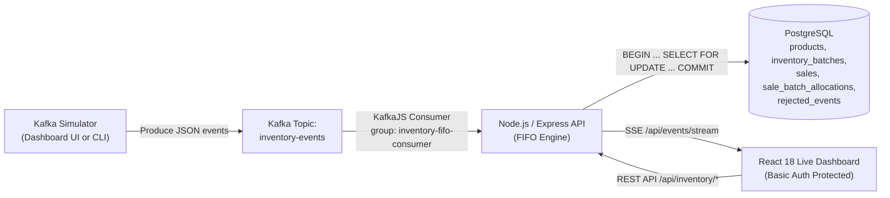

# Inventory Management System (FIFO) — Real-Time Event Streaming & Live Dashboard

A full-stack perpetual inventory management and costing platform implementing the **First-In, First-Out (FIFO)** accounting method. Inventory purchase and sale events stream through **Apache Kafka** (`inventory-events`), are processed inside ACID-compliant **PostgreSQL** transactions with row-level locking, and push real-time updates to a **React 18** dashboard via **Server-Sent Events (SSE)**.

---

## Live Deployment & Repository Links

- **GitHub Repository**: https://github.com/RohitSah62/Inventory-Management-System
- **Live Backend API (Render)**: https://inventory-fifo-api.onrender.com
- **API Health Check**: https://inventory-fifo-api.onrender.com/health
- **Live Frontend Dashboard**: https://inventory-fifo-dashboard.onrender.com/

> **Security Notice:** Never commit `.env` files, API keys, or production credentials to version control. In production (`NODE_ENV=production`), `AUTH_USERNAME`, `AUTH_PASSWORD`, `DATABASE_URL`, `KAFKA_BROKERS`, and an explicit `CORS_ORIGIN` (wildcards are rejected) are strictly required and must be configured through your hosting provider's environment variable settings.

---

## Features

- **Real-Time Kafka Event Pipeline**: Produces and consumes `purchase` and `sale` JSON events on topic `inventory-events` using `kafkajs` (supports local Redpanda and managed SASL/SSL Redpanda Cloud).
- **ACID-Compliant FIFO Costing Engine**: Allocates sales against the oldest active inventory batches (`ORDER BY purchased_at ASC, id ASC FOR UPDATE`) inside PostgreSQL transactions.
- **Exact Batch-Level Audit Trail**: Tracks every batch deduction in `sale_batch_allocations` with exact `quantity_consumed`, `unit_price`, and `cost`.
- **Precision & Idempotency**: Uses scaled integer math (`SCALE = 10000`, `NUMERIC(18, 4)`) to prevent floating-point drift and deduplicates events via unique `event_id` constraints.
- **Insufficient Stock Rejection**: Automatically rolls back sales that exceed available inventory and logs them in `rejected_events` without mutating stock levels.
- **Live Dashboard Updates (SSE)**: Streams `inventory_updated` and `event_rejected` events to connected clients over `/api/events/stream`.
- **Interactive Kafka Event Simulator**: Built-in UI simulator (single events and 5–10 transaction batches) plus a standalone CLI simulator (`backend/scripts/kafka-simulator.js`).
- **Protected Access**: HTTP Basic Auth (`timingSafeEqual`) on all API and SSE endpoints, with Helmet security headers and explicit CORS enforcement.

---

## Technology Stack

| Layer | Technology |
|---|---|
| **Backend Runtime & Framework** | Node.js (>=20), Express 4.21 |
| **Frontend** | React 18, Vite 6, Lucide React |
| **Database** | PostgreSQL (`pg` driver, `NUMERIC(18, 4)` precision) |
| **Event Streaming** | Apache Kafka (`kafkajs`), Redpanda (local Docker & Redpanda Cloud Serverless) |
| **Real-Time Updates** | Server-Sent Events (SSE) |
| **Security** | HTTP Basic Auth, `helmet`, `cors`, environment validation |
| **Testing** | Node.js built-in test runner (`node --test`), `pg-mem`, `supertest` |
| **Deployment** | Render (Backend Web Service & PostgreSQL), Redpanda Cloud, Vercel / Render Static (Frontend) |

---

## System Architecture



### Project Structure

```text
├── backend/
│   ├── scripts/
│   │   └── kafka-simulator.js         # Standalone CLI Kafka event producer
│   ├── src/
│   │   ├── config/
│   │   │   └── env.js                 # Environment validation & config builder
│   │   ├── db/
│   │   │   ├── migrate.js             # Idempotent schema migration runner
│   │   │   ├── pool.js                # PostgreSQL connection pool
│   │   │   └── schema.sql             # Database tables, constraints & FIFO indexes
│   │   ├── kafka/
│   │   │   ├── client.js              # KafkaJS client (plain & SASL/SSL)
│   │   │   ├── consumer.js            # Kafka consumer on inventory-events
│   │   │   ├── producer.js            # Kafka producer wrapper
│   │   │   ├── simulatorEvents.js     # Chronological batch event generator
│   │   │   └── topic.js               # Local dev topic creation helper
│   │   ├── middleware/
│   │   │   └── basicAuth.js           # Timing-safe HTTP Basic Auth middleware
│   │   ├── routes/
│   │   │   ├── auth.js                # GET /api/auth/verify
│   │   │   ├── events.js              # GET /api/events/stream, POST /api/events/simulate
│   │   │   ├── health.js              # GET /health
│   │   │   └── inventory.js           # Overview, ledger, batches, rejected endpoints
│   │   ├── services/
│   │   │   ├── eventBus.js            # In-memory SSE pub/sub bus
│   │   │   └── fifoService.js         # Core ACID FIFO engine & reporting queries
│   │   ├── app.js                     # Express app factory
│   │   └── index.js                   # Server, DB migration & Kafka bootstrap
│   ├── tests/
│   │   └── fifoService.test.js        # Automated FIFO, Kafka & API tests
│   ├── .env.example                   # Backend environment variable template
│   └── package.json
├── frontend/
│   ├── src/
│   │   ├── api/client.js              # Authenticated REST & SSE client
│   │   ├── components/
│   │   │   ├── Dashboard.jsx          # Main dashboard layout & live SSE handler
│   │   │   ├── LoginPage.jsx          # Basic Auth login form
│   │   │   ├── SimulatorPanel.jsx     # Batch & single-event Kafka simulator UI
│   │   │   ├── StockOverview.jsx      # Product stock & batch valuation table
│   │   │   └── TransactionLedger.jsx  # Chronological ledger with FIFO allocations
│   │   ├── App.jsx
│   │   ├── index.css
│   │   └── main.jsx
│   ├── .env.example                   # Frontend environment variable template
│   ├── package.json
│   ├── vercel.json                    # SPA rewrite rules for Vercel
│   └── vite.config.js
├── docker-compose.yml                 # Local PostgreSQL 16 + Redpanda + Console
├── render.yaml                        # Render Blueprint (DB + API + Frontend)
└── README.md
```

---

## FIFO Algorithm Explanation

The FIFO engine in `backend/src/services/fifoService.js` processes two event types:

1. **Purchase Events (`event_type: "purchase"`)**
   - Upserts the product into `products`.
   - Checks `event_id` for idempotency; duplicate events are ignored safely.
   - Inserts a new batch into `inventory_batches` with `initial_quantity = remaining_quantity = quantity`, `unit_price`, and `purchased_at`.

2. **Sale Events (`event_type: "sale"`)**
   - Starts an ACID PostgreSQL transaction (`BEGIN`) and checks `event_id` for duplicates.
   - Locks all active batches for the `product_id` in chronological FIFO order:
     ```sql
     SELECT id, remaining_quantity, unit_price, purchased_at
     FROM inventory_batches
     WHERE product_id = $1 AND remaining_quantity > 0
     ORDER BY purchased_at ASC, id ASC
     FOR UPDATE;
     ```
   - **Stock Check**: Sums `remaining_quantity` using scaled integer math (`× 10000`). If available stock is less than the requested quantity, executes `ROLLBACK`, records the failure in `rejected_events`, and emits an `event_rejected` SSE alert. Inventory remains unchanged.
   - **Batch Allocation**: Iterates from the oldest batch forward, deducting `min(remaining_needed, batch.remaining_quantity)` from each batch, updating `inventory_batches.remaining_quantity`, and accumulating exact cost (`quantity_consumed × batch.unit_price`).
   - **Persistence**: Inserts the sale summary into `sales`, writes each batch deduction into `sale_batch_allocations`, commits (`COMMIT`), and broadcasts `inventory_updated` over SSE.

### Worked Example

1. **Purchase 1**: `PRD001`, Qty `50` @ `$100.00` → Batch #1 (`remaining: 50`, `$100.00`)
2. **Purchase 2**: `PRD001`, Qty `30` @ `$120.00` → Batch #2 (`remaining: 30`, `$120.00`)
3. **Sale**: `PRD001`, Qty `60`
   - Consumes `50` units from Batch #1 (`50 × $100.00 = $5,000.00`)
   - Consumes `10` units from Batch #2 (`10 × $120.00 = $1,200.00`)
   - **Total FIFO COGS**: `$6,200.00` (`$103.3333 / unit`)
   - **Remaining Inventory**: `20` units in Batch #2 @ `$120.00` (`$2,400.00` total value)
4. **Insufficient-Stock Sale**: `PRD001`, Qty `25` (only `20` available)
   - Transaction rolls back; `0` inventory deducted; reason logged in `rejected_events`.

---

## Installation & Local Setup

### Prerequisites
- **Node.js** `>= 20.0.0` and `npm`
- **Docker & Docker Compose** (for local PostgreSQL and Redpanda Kafka)

### 1. Start Local Infrastructure (PostgreSQL + Redpanda)

```bash
docker compose up -d
```

Services started:
- **PostgreSQL 16**: `localhost:5432` (`inventory_fifo`)
- **Redpanda (Kafka API)**: `localhost:19092`
- **Redpanda Console**: `http://localhost:8080`

### 2. Configure & Start the Backend

```bash
cd backend
cp .env.example .env
# Edit backend/.env with your local development values
npm install
npm run migrate
npm run dev
```

Backend API runs on `http://localhost:4000`.

### 3. Configure & Start the Frontend

```bash
cd frontend
cp .env.example .env
npm install
npm run dev
```

Open `http://localhost:5173` and log in using the `AUTH_USERNAME` and `AUTH_PASSWORD` configured in your local `backend/.env`.

### 4. Run the Standalone Kafka Simulator (Optional)

```bash
cd backend
npm run simulate
# Or customize count (5-10) and delay (ms):
node scripts/kafka-simulator.js --count 8 --delay 400
```

---

## Environment Variables

Configure these variables in `backend/.env` / `frontend/.env` locally, or in your cloud provider's environment settings for production. **Never commit actual credentials.**

### Backend (`backend/.env.example`)

| Variable | Description |
|---|---|
| `PORT` | HTTP server port (default `4000`) |
| `NODE_ENV` | `development` or `production` |
| `CORS_ORIGIN` | Allowed frontend origin URL (explicit origin required in `production`; `*` is rejected) |
| `AUTH_USERNAME` | Basic Auth username (required in `production`) |
| `AUTH_PASSWORD` | Basic Auth password (required in `production`; never reuse local placeholders) |
| `DATABASE_URL` | PostgreSQL connection URI (required in `production`) |
| `DATABASE_SSL` | `true` for managed cloud PostgreSQL, `false` for local Docker |
| `KAFKA_BROKERS` | Comma-separated Kafka broker host:port list (required in `production`) |
| `KAFKA_TOPIC` | Kafka topic name (`inventory-events`) |
| `KAFKA_GROUP_ID` | Kafka consumer group ID (`inventory-fifo-consumer`) |
| `KAFKA_CLIENT_ID` | Kafka client identifier (`inventory-fifo-service`) |
| `KAFKA_SSL` | `true` for TLS/SASL_SSL brokers (e.g., Redpanda Cloud) |
| `KAFKA_SASL_MECHANISM` | SASL mechanism (e.g., `scram-sha-256` or `scram-sha-512`) |
| `KAFKA_SASL_USERNAME` | Managed Kafka SASL username |
| `KAFKA_SASL_PASSWORD` | Managed Kafka SASL password |

### Frontend (`frontend/.env.example`)

| Variable | Description |
|---|---|
| `VITE_API_BASE_URL` | Public base URL of the backend API (e.g., `http://localhost:4000` locally or `https://inventory-fifo-api.onrender.com` in production) |

---

## API Endpoints

All `/api/*` endpoints require HTTP Basic Auth (`Authorization: Basic <base64(username:password)>`). For `/api/events/stream`, SSE clients may pass `?auth=<base64>` because browser `EventSource` does not support custom headers.

| Method | Endpoint | Auth | Description |
|---|---|---|---|
| `GET` | `/` | Public | Service info and health route reference |
| `GET` | `/health` | Public | Database connectivity and Kafka producer/consumer status |
| `GET` | `/api/auth/verify` | Basic Auth | Verifies Basic Auth credentials |
| `GET` | `/api/inventory/overview` | Basic Auth | Current stock quantity, total FIFO valuation, avg unit cost, and active batch count per SKU |
| `GET` | `/api/inventory/batches/:productId` | Basic Auth | Active batches for a SKU in FIFO order (`?include_exhausted=true` to include depleted batches) |
| `GET` | `/api/inventory/ledger` | Basic Auth | Chronological purchase & sale history with `allocations` breakdown (`?product_id=`, `?event_type=`, `?limit=`) |
| `GET` | `/api/inventory/rejected` | Basic Auth | Audit log of rejected/invalid events (`?limit=`) |
| `POST` | `/api/events/simulate` | Basic Auth | Publishes `{ event }` (single purchase/sale) or `{ count }` (5–10 batch) to Kafka topic `inventory-events` |
| `GET` | `/api/events/stream` | Basic Auth (header or `?auth=`) | Server-Sent Events stream (`connected`, `inventory_updated`, `event_rejected`) |

---

## Testing Instructions

### Automated Backend Test Suite

The backend test suite uses `node --test`, `pg-mem`, and `supertest` to verify multi-batch FIFO consumption, decimal precision, insufficient-stock rejection, `event_id` idempotency, Kafka consumer message handling, and authenticated API routes:

```bash
cd backend
npm test
```

Expected result: **5/5 tests pass**.

### Frontend Production Build Check

```bash
cd frontend
npm run build
```

### Verified End-to-End Scenarios

1. **Purchase Event via Kafka**: Producing a purchase event creates a product record and an active batch in `inventory_batches`.
2. **Single-Batch FIFO Sale**: Selling fewer units than the oldest batch consumes solely from that batch and computes exact COGS.
3. **Multi-Batch FIFO Allocation**: Selling across batch boundaries drains the oldest batch completely before consuming from the next batch in `purchased_at` order.
4. **Inventory Valuation & COGS**: Remaining stock valuation and average unit cost update accurately after every allocation.
5. **Insufficient Stock Rejection**: Requesting more units than available rolls back the PostgreSQL transaction, preserves inventory unchanged, and records the rejection in `rejected_events`.
