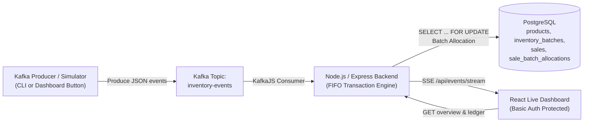

# Inventory Management System (FIFO) — Real-Time Ingestion & Live Dashboard

A full-stack perpetual inventory management and costing platform using the **First-In, First-Out (FIFO)** accounting method. Inventory purchase and sale events stream through **Apache Kafka** (`inventory-events`), are processed transactionally in **PostgreSQL**, and push real-time updates to a **React** dashboard over **Server-Sent Events (SSE)**.

---

## Live Links & Authentication

> Update the URL placeholders once you deploy the services to Render / Railway / Vercel and connect your managed Kafka cluster (Redpanda Cloud or Confluent Cloud).
>
> **Security Notice:** Never commit production credentials, `.env` files, or secrets to GitHub. In production (`NODE_ENV=production`), `AUTH_USERNAME`, `AUTH_PASSWORD`, `DATABASE_URL`, `KAFKA_BROKERS`, and an explicit `CORS_ORIGIN` are strictly required and must be configured through your hosting provider's environment variable settings (for example, Render Environment Variables, Railway Variables, or Vercel Project Settings).

- **Live Frontend URL**: `<YOUR_FRONTEND_URL>` (e.g. `https://inventory-fifo-dashboard.vercel.app`)
- **Live Backend API URL**: `<YOUR_BACKEND_URL>` (e.g. `https://inventory-fifo-api.onrender.com`)
- **Health Check Endpoint**: `<YOUR_BACKEND_URL>/health`
- **Local Development Only — Demo Login (Basic Auth)**:
  - **User ID**: `admin` (local dev default via `AUTH_USERNAME` in `backend/.env`)
  - **Password**: Set `AUTH_PASSWORD` in your local `backend/.env` (the template `backend/.env.example` uses the placeholder `change-me-local-dev-only` for local development only — **never** reuse local dev credentials in production)

---

## Architecture



---

## Brief on FIFO Costing Logic

1. **Purchase Events (`event_type: "purchase"`)**
   - Upserts the product record in `products`.
   - Inserts a new batch in `inventory_batches` with `initial_quantity = remaining_quantity = quantity`, `unit_price`, and `purchased_at`.
2. **Sale Events (`event_type: "sale"`)**
   - Opens an ACID PostgreSQL transaction (`BEGIN ... COMMIT`).
   - Locks all non-empty batches for the `product_id` in chronological FIFO order:
     ```sql
     SELECT id, remaining_quantity, unit_price, purchased_at
     FROM inventory_batches
     WHERE product_id = $1 AND remaining_quantity > 0
     ORDER BY purchased_at ASC, id ASC
     FOR UPDATE;
     ```
   - Iterates from the oldest batch forward, deducting `min(needed, batch.remaining_quantity)` from each batch until the sale quantity is fulfilled.
   - Records the sale total in `sales` and stores each individual batch deduction (`batch_id`, `quantity_consumed`, `unit_price`, `cost`) in `sale_batch_allocations`.
   - If total available stock is less than the requested sale quantity, the transaction rolls back cleanly and logs the rejection in `rejected_events` (surfacing a live alert in the dashboard).

### Worked Example
- **Purchase 1**: `PRD001`, Qty `50` @ `$100.00` → Batch #1 (`rem: 50`, `$100`)
- **Purchase 2**: `PRD001`, Qty `30` @ `$120.00` → Batch #2 (`rem: 30`, `$120`)
- **Sale 1**: `PRD001`, Qty `60`
  - Consumes `50` from Batch #1 (`50 × $100 = $5,000`)
  - Consumes `10` from Batch #2 (`10 × $120 = $1,200`)
  - **Total FIFO Cost**: `$6,200.00` (`$103.33 / unit`)
- **Remaining Inventory**: `20` units in Batch #2 @ `$120.00` → **Total Inventory Cost**: `$2,400.00`, **Avg Cost / Unit**: `$120.00`

---

## Project Structure

```text
├── backend/
│   ├── scripts/kafka-simulator.js     # Standalone Kafka producer script
│   ├── src/
│   │   ├── config/env.js              # Environment configuration
│   │   ├── db/
│   │   │   ├── schema.sql             # PostgreSQL tables & FIFO indexes
│   │   │   ├── pool.js                # pg Pool setup
│   │   │   └── migrate.js             # Schema migration runner
│   │   ├── kafka/
│   │   │   ├── client.js              # KafkaJS client (plain & SASL/SSL)
│   │   │   ├── topic.js               # Ensures inventory-events topic exists
│   │   │   ├── producer.js            # Kafka producer wrapper
│   │   │   ├── consumer.js            # Kafka consumer listening on inventory-events
│   │   │   └── simulatorEvents.js     # Realistic 5-10 event generator
│   │   ├── middleware/basicAuth.js    # HTTP Basic Auth protection
│   │   ├── routes/                    # health, auth, inventory, events (SSE & simulate)
│   │   ├── services/
│   │   │   ├── fifoService.js         # Core ACID FIFO engine & ledger queries
│   │   │   └── eventBus.js            # Live SSE broadcaster
│   │   ├── app.js                     # Express application factory
│   │   └── index.js                   # Server & Kafka bootstrap
│   └── tests/fifoService.test.js      # Automated unit & API tests
├── frontend/
│   ├── src/
│   │   ├── api/client.js              # Basic Auth API + SSE client
│   │   └── components/                # LoginPage, Dashboard, StockOverview, TransactionLedger, SimulatorPanel
│   └── vercel.json                    # Vercel SPA rewrite rules
├── docker-compose.yml                 # Local PostgreSQL + Redpanda + Redpanda Console
└── render.yaml                        # Render Blueprint (DB + Backend + Frontend)
```

---

## Running Locally

### 1. Start PostgreSQL & Redpanda (Kafka) via Docker Compose

```bash
docker compose up -d
```

This starts:
- **PostgreSQL** on `localhost:5432` (`inventory_fifo`)
- **Redpanda (Kafka API)** on `localhost:19092`
- **Redpanda Console** on `http://localhost:8080`

### 2. Configure and Start the Backend

```bash
cd backend
cp .env.example .env
npm install
npm run migrate
npm run dev
```

Backend runs on `http://localhost:4000`.

### 3. Run the Kafka Producer Simulator Locally

To stream a batch of 8 purchase/sale events to the `inventory-events` Kafka topic:

```bash
cd backend
npm run simulate
```

Custom count (5–10) and delay (ms):

```bash
node scripts/kafka-simulator.js --count 10 --delay 400
```

To point the local simulator at a **managed Kafka** cluster (Redpanda Cloud / Confluent Cloud), set these in `backend/.env`:

```env
KAFKA_BROKERS=<your-broker-host>:9092
KAFKA_SSL=true
KAFKA_SASL_MECHANISM=scram-sha-256
KAFKA_SASL_USERNAME=<your-sasl-username>
KAFKA_SASL_PASSWORD=<your-sasl-password>
```

### 4. Start the Frontend Dashboard

```bash
cd frontend
cp .env.example .env
npm install
npm run dev
```

Open `http://localhost:5173` and sign in using the local development `AUTH_USERNAME` and `AUTH_PASSWORD` configured in `backend/.env`.

---

## Running Automated Tests

The backend test suite verifies FIFO multi-batch consumption, decimal precision, insufficient-stock rejection, idempotency, Kafka message handling, and Basic Auth API endpoints:

```bash
cd backend
npm test
```

---

## Deploying End-to-End

1. **Managed Kafka**: Create a free Serverless cluster on **Redpanda Cloud** or **Confluent Cloud**, create topic `inventory-events` (or let the app auto-create it), and generate SCRAM/SASL credentials.
2. **PostgreSQL + Backend (Render / Railway / Fly.io)**:
   - Provision a PostgreSQL instance (Render Postgres, Railway Postgres, or Neon).
   - Deploy `backend/` as a Web Service (`npm install`, `npm start`) and configure all production secrets through your hosting provider's environment settings (never commit `.env` or reuse `.env.example` passwords). Required production variables: `NODE_ENV=production`, `AUTH_USERNAME`, a strong unique `AUTH_PASSWORD`, `DATABASE_URL` (with `DATABASE_SSL=true`), `KAFKA_BROKERS` (with `KAFKA_SSL=true` + SASL credentials), and an explicit `CORS_ORIGIN=<your-frontend-url>` (wildcard `*` is rejected in production).
3. **Frontend (Vercel / Render Static)**:
   - Deploy `frontend/` (`npm run build`, output directory `dist`).
   - Set `VITE_API_BASE_URL=<your-backend-public-url>`.
